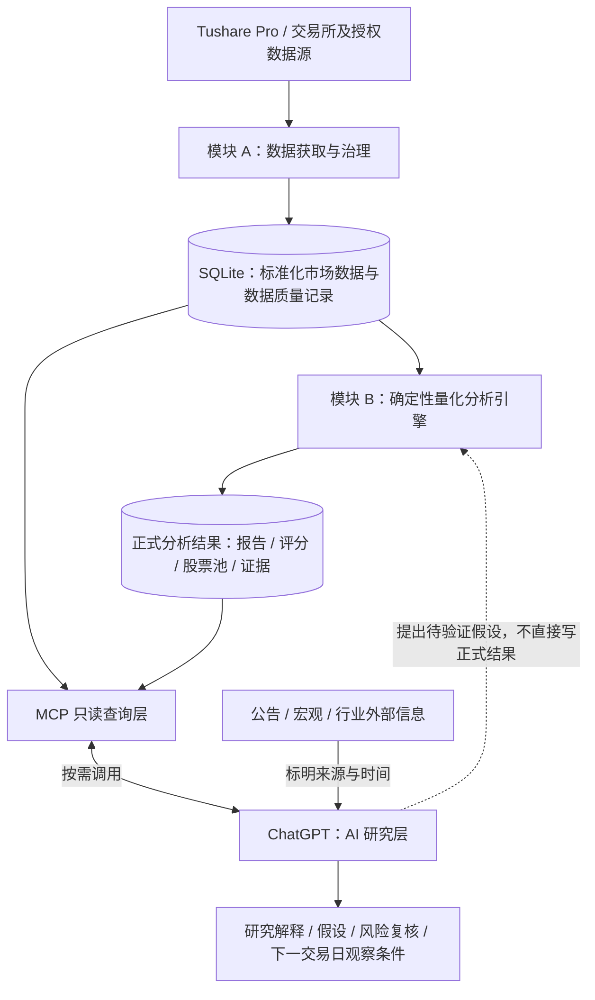

# A 股数据服务、量化分析引擎与 ChatGPT 研究层架构

> 状态：目标架构与分阶段实施方案（2026-10-17）。
>
> 当前 A 股实现参考 [`ashare-v1-fix2`](https://github.com/jingchangshi/FinanceMCP/tree/ashare-v1-fix2) 功能分支。本文合入 `main` 仅表示接受架构文档，**不表示 A 股代码已合入 `main` 或真实交易日验收已完成**。实际落地状态以分支、部署日志和 [验收记录](https://github.com/jingchangshi/FinanceMCP/blob/ashare-v1-fix2/docs/ashare-acceptance.md) 为准。

## 1. 目标和非目标

**目标：** 在同一套 FinanceMCP 部署中分离可信数据、可复现量化计算、灵活 AI 研究三个职责。ChatGPT 可提出研究假设、复核结论，但不能代替数据引擎产生行情事实。

- 数据获取模块提供带交易日、来源、质量状态的市场数据和财务数据。
- 量化分析引擎消费这些数据，计算指标、信号、评分、股票池及历史检验。
- MCP 接口按需返回结构化数据和分析证据。
- ChatGPT 消费 MCP 结果，结合有出处的公告、政策和产业信息，解释市场与股票，并提出下一步研究问题。

**本阶段不做：** 拆分多个服务或容器、建立第二套行情库存储、训练预测模型、根据少量历史收益调评分权重、将研究股票池当作真实持仓、让 ChatGPT 写入正式股票池。

## 2. 逻辑架构

模块划分是**代码依赖边界**，不是物理部署边界。当前宜维持一个 TypeScript 仓库、一个 Oracle VPS 容器和 SQLite；以后只有在资源、隔离或可维护性证据充分时才考虑拆分进程。

## 3. 职责与所有权

| 能力 | 模块 A：数据获取 | 模块 B：量化分析 | ChatGPT |
| --- | --- | --- | --- |
| 交易日历、行情、复权、停牌及涨跌停 | 获取、清洗、核验和记录来源 | 只读取标准数据 | 审阅异常提示 |
| 财务数据、估值、公告日约束 | 保存原值与可得时间 | 计算客观因子及比较 | 结合业务和公告作解释 |
| MA、RSI、MACD、CCI、ATR、量价结构 | 提供价格与成交数据 | 计算并版本化 | 解释信号、检查相关性 |
| 市场状态和行业强度 | 提供所需观测值 | 生成可复现结果 | 结合宏观与产业背景复核 |
| 正式动态股票池（目标 30～50 只） | 不负责入池判断 | 唯一正式维护者 | 仅提出候选与风险复核 |
| 历史检验及样本外评估 | 提供按时间可得的数据 | 计算、记录假设与版本 | 审阅偏差、解释结果 |
| 日报和个股研究 | 提供数据状态 | 提供指标与证据 | 生成综合研究结论 |

**禁止双重事实源：** ChatGPT 不应独立重算正式评分后将结果冒充 FinanceMCP 评分。ChatGPT 的解释或判断必须与系统原始测量值、量化结果分开标注。

**允许开放式研究：** ChatGPT 可以提出不在当前评分引擎内的假设，如行业估值修复、事件驱动、信号共线性。涉及全市场回放或统计时，由确定性代码执行计算并返回摘要。

## 4. 数据模块的契约

### 4.1 数据与时间语义

数据模块应同时记录：

- `trade_date`：交易所对应的交易日，格式 `YYYYMMDD`。
- `source`：数据提供者与接口；必要时记录调用或同步批次。
- `synced_at`：本地实际获取时间，不等于市场数据发布时间。
- `ann_date` / 实际披露日：财务与公告数据用于历史分析的可得性约束。
- `as_of_trade_date`：分析或报告所允许使用的最后交易日。
- `version`：数据定义、指标、信号和评分规则分别版本化。

历史回放不应读取 `as_of_trade_date` 之后的价格、财报或证据分类。当前行业分类可能不是历史当日分类，历史结果必须提示该局限。

### 4.2 缓存质量与刷新质量

缓存完整性与最新上游刷新必须分别表示：

- `READY`：核心缓存完整，且未发现应当披露的最新刷新异常。
- `DEGRADED`：已有可用缓存，但非核心数据不足或最新刷新不完整/失败；报告必须说明采用了哪次有效快照。
- `NOT_READY`：核心行情、复权或其他强制条件不足；不得发布未经支持的市场判断。
- `PENDING`：目标交易日数据可能已齐，但正式报告尚未发布；不得拿上一交易日报告冒充当天报告。

`REFRESH_OK`、`REFRESH_INCOMPLETE` 和 `REFRESH_FAILED` 描述**请求结果**，不等于上述**最终数据质量**。当上游短返回时，数据模块优先保留已验证的完整快照，不将短返回混入该快照。正式日报需要显示最新刷新异常。

### 4.3 正式与研究隔离

- `ashare.sqlite`：正式行情缓存、正式评分、正式股票池、正式日报。
- `research.sqlite`：历史回放和手动研究报告；只读使用正式行情，维护自己的派生状态。
- 正式日频 `daily` 流水线是正式报告和股票池的唯一写入入口。
- `report --date` 与 `replay` 始终进入研究库。
- MCP 进程只读正式数据库；schema 迁移在启动/管理命令中执行。

研究验证不能重写正式 `latest.json`、`watchlist` 或历史正式评分。

## 5. 量化分析引擎的职责

引擎应输出可复核的**计算事实**，而不是直接输出无条件买卖指令：

1. 技术指标、趋势、相对强弱、量价与波动率特征。
2. 明确触发条件和失效条件的技术信号。
3. 按公告日限制的基本面、估值及风险因子。
4. 市场状态、行业强度和分散化约束。
5. 正式股票池的入选、移出、评分版本及变更理由。
6. 历史事件统计、比较基准、持有期、样本量和风险限制。

目前的 `score-1.0.0` 和 `evi-1.0.0` 属于**研究基线**。样本内方向性证据不是可验证的盈利概率。历史结果需说明收益窗口重叠、多重检验、交易费用和样本外验证限制。数据层验收时不应为了改善负面历史表现而调整评分权重。

正式股票池（量化维护）和 AI 重点研究清单（ChatGPT 输出）是两个不同对象：后者不能隐式修改前者。

## 6. MCP 接口：当前能力与下一阶段扩展

功能分支当前提供五个只读工具：

| 已实现工具 | 用途 |
| --- | --- |
| `ashare_data_status` | 检查交易日、数据质量、刷新及报告状态 |
| `ashare_daily_report` | 获取指定交易日的正式研究报告 |
| `ashare_watchlist` | 读取正式股票池及近期增减 |
| `ashare_stock_analysis` | 读取单股指标、基本面及信号解释 |
| `ashare_sector_rank` | 读取行业强弱排名 |

下一阶段可在现有模块上增加**候选查询接口**（名称、字段和分页规则仍需设计，不代表已经实现）：

| 候选接口 | 优先返回的信息 |
| --- | --- |
| `ashare_market_data` | 指定日期/区间的市场行情与宽度 |
| `ashare_stock_history` | 指定股票在受限区间的复权行情、成交量和估值 |
| `ashare_financial_data` | 按公告日可得的财务历史 |
| `ashare_factor_snapshot` | 某日指定股票集的标准化特征 |

接口应限制股票数量、日期区间和响应体积。全市场历史事件统计应在 VPS 执行，只向 ChatGPT 返回统计摘要、样本范围、版本和必要明细；不应将全部历史 K 线发送给大模型。避免与当前工具重复定义相同字段的另一套口径。

## 7. ChatGPT 研究层的工作契约

ChatGPT 可承担以下职责：

- 解释指数、行业、股票之间的关系，并提出可证伪的研究假设。
- 在量化结果与政策、行业消息、公告发生冲突时指出冲突，不自动以某一来源取代全部证据。
- 检查多个技术信号是否共享同一价格变化，避免重复计算证据。
- 为重点股票给出关注原因、确认条件、失效条件和风险。
- 要求 VPS 按固定定义验证研究假设；不得臆造回测结果。
- 将“数据事实”“确定性分析结果”“AI 解释”“待验证假设”明确分开。

ChatGPT 不应直接写正式股票池，不应修改评分版本，不应把 `evidence_supported` 解释为经过样本外验证的买入信号。

### 7.1 日频协作流程

北京时间（`Asia/Shanghai`）的现有设计：

1. 18:40：VPS 第一次尝试获取当日数据并生成正式报告。
2. 21:10：VPS 复查数据源，记录请求质量，更新正式报告。
3. 21:40：已有 ChatGPT 工作日日报任务优先调用 `ashare_daily_report`，根据需要再调用其余只读工具。
4. ChatGPT 核查 `as_of_trade_date`、`report_id`、`generated_at`、数据质量和股票池数量。
5. 如果报告为 `NOT_READY` 或 `PENDING`，仅解释缺失状态；如果报告为 `DEGRADED`，限制结论并说明缺失或沿用缓存。
6. ChatGPT 输出市场解释、行业研究、正式股票池变化和下一交易日的观察条件。研究信号不直接等同于买卖建议。

任务时间与 VPS 调度时间属于两个独立的计划。修改其中一个，不代表另一个已经同步修改。

## 8. 分阶段实施和验收

### 阶段 A：数据服务稳定性

优先完成真实交易日的数据完整性、刷新异常恢复、公告日约束、历史查询口径和 MCP 一致性验证。2026-10-19 至 2026-10-21 连续三交易日的验收必须由真实执行日志支持；两次数据库记录不能代替 systemd journal 对调度来源的核查。

**阶段 A 完成定义：** 指定交易日的结构化数据可稳定读取；报告状态真实反映数据质量；研究操作不改写正式状态；三日自动运行的相关证据可复核。

### 阶段 B：独立演进分析引擎

在冻结的数据输入契约上定义分析目标、比较基准和样本外验证。检验策略时应处理停牌、涨跌停不可成交、退市、交易成本、风格暴露及重叠持有期。新旧评分规则应使用不同版本号和同一数据口径比较；不覆盖旧结果。

**阶段 B 完成定义：** 研究假设、数据截止日、规则版本和实际结果可复现，且样本外结果与样本内统计分开报告。

### 阶段 C：ChatGPT 持续研究

在阶段 A、B 提供的可靠工具结果基础上，形成定时日报与按需深度研究。AI 研究结论应包含来源、证据冲突、风险和可验证的后续观察条件。

**阶段 C 完成定义：** AI 输出能够回溯至具体数据、报告版本及研究假设，不把 AI 推断伪装成已验证的策略结果。

## 9. 当前代码映射（功能分支）

| 代码 | 当前职责 | 长期边界 |
| --- | --- | --- |
| `src/ashare/fetch.ts`、`ingest.ts`、`sync.ts` | 数据源调用、日历、同步及质量检查 | 模块 A |
| `src/ashare/db.ts`、`bars.ts` | SQLite、研究库隔离及行情序列 | A 与 B 之间的标准数据访问边界 |
| `src/ashare/indicators.ts`、`signals.ts` | 指标和信号 | 模块 B |
| `src/ashare/analysis.ts`、`watchlist.ts`、`evidence.ts` | 评分、股票池、研究统计 | 模块 B |
| `src/ashare/report.ts`、`tools.ts`、`definitions.ts` | 报告和 MCP 查询 | 结果发布及访问接口 |
| `deploy/ashare/` | 容器、定时器和验收脚本 | 部署与运维 |

后续只在实际需求驱动下调整目录和依赖方向，不以拆分文件或容器数量作为验收目标。

## 10. 风险和决策记录

- **匿名 MCP 入口：** 当前部署允许知道 URL 的访问者读取研究数据。公开程度、访问负载与 Tushare 数据再分发许可需由部署者承担并持续评估。
- **研究与持仓分离：** 股票池是研究观察集，不是实际持仓、收益承诺或自动交易策略。
- **数据时间一致性：** 财务公告日期与历史可得性不等价于所有来源都具有完整 PIT 历史；不得声称未具备的历史还原能力。
- **版本兼容：** 现有五个工具保持稳定。新增数据接口应优先补足缺失查询能力，而不是重复已有报告和股票池工具。
- **避免过度设计：** 无证据表明单容器/SQLite 是瓶颈前，不增加额外数据库、队列、专用服务或通用回测平台。
